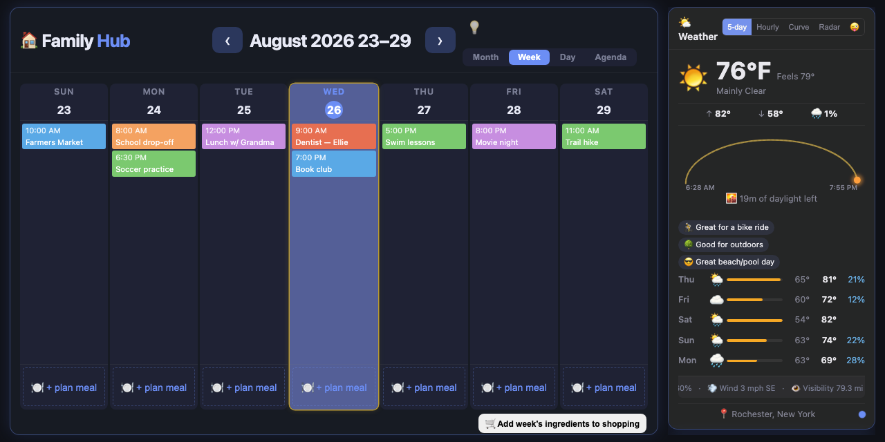

# 🏠 Family Hub

> A no-build family wall dashboard — Google Calendar, keyless weather, shared
> shopping/to-do/budget, AI meal planning, chores and an ambient screensaver.

[](LICENSE)
[](#what-it-is)
[](family-hub.js)
[](manifest.json)
[](netlify.toml)

**[Setup guide](family-hub-setup.md)** · **[Feature reference](FEATURES.md)** · **[Easter eggs](EASTER_EGGS.md)** · **[Architecture notes](CLAUDE.md)**



---

A wall-display family dashboard — calendar, weather, shopping, meals, chores and more — built as **three plain files** with no build step, no npm install, and no framework.

`family-hub.html` + `family-hub.css` + `family-hub.js`. Drop them in a folder, serve them, done.

---

## What it is

Family Hub is the screen that lives on the kitchen wall. It pulls in everyone's Google
Calendars, shows the weather and the radar, keeps a shared shopping list that updates on
every phone in the house at once, plans the week's meals, tracks chores, and fades into a
screensaver when nobody's looking at it.

It's deliberately low-tech under the hood: CDN `<script>` tags (Firebase 9 compat + Google
Identity Services), vanilla JS, CSS custom properties. There is nothing to compile — what
you edit is what the browser runs.

## Features

**Calendar**
- Month / Week / Day views over multiple Google Calendars, colour-coded and individually toggleable
- **ICS subscriptions** — subscribe to any public or secret `.ics` feed (school, sports, Outlook) with no Google sign-in at all; recurrence (`RRULE`/`EXDATE`/`TZID`) is expanded client-side
- Year at a Glance mini-month strip, countdowns, and conflict detection
- **Recurring items** (medications, trash and recycling, air filters, smoke alarm checks) on any every-N-days/weeks/months/years schedule, shown as their own calendar

**Household**
- **Shopping list**, **to-do list** and **budget** — shared in real time via Firestore, live on every device
- **Meal planning** with AI suggestions (Gemini), diet prefs and pantry awareness; accepted meals can push their ingredients straight to the shopping list
- **Chore chart** with family members and rotation
- **Family Assistant** — natural-language questions about the household's data

**Ambient**
- **Weather** — current conditions, forecast, RainViewer radar and NWS alerts, all keyless (Open-Meteo)
- **Outdoor task advisor** — scores the coming week's forecast against your calendar to pick the best window to mow the lawn
- **Event discovery** — nearby things to do, aggregated from Ticketmaster, library feeds, Red Wings, CitySpark and the Fairport/Pittsford town calendars
- **Word of the Day**, **Dad Joke of the Day**, quotes, news headlines and stock tickers as optional widgets, plus a set of [easter eggs](EASTER_EGGS.md)
- **Google Photos background slideshow** (photos cached as blobs in IndexedDB)
- **Screensaver** — photo slideshow, clock, or the [Pond Chimes](https://github.com/mattohara42/pond-chimes) ambient pond, vendored in `pond/`

**Presentation**
- Five themes — Dark (default), Light, Nautical, Aurora, Colorblind — on a colour axis
- Two flavors — Basic (flat glass) and Tactile (lush, hand-made material, self-hosted Fraunces/Hanken) — orthogonal to theme, so they stack
- Configurable widget placement and ordering on desktop; a registry-driven bottom-tab layout on phones
- Installable PWA with a network-first service worker, so the wall panel survives a flaky connection

## Quick start

```bash
git clone https://github.com/mattohara42/family-hub.git
cd family-hub
python3 -m http.server 8080
```

Then open **http://localhost:8080/family-hub.html**.

> ⚠️ Opening the file directly (`file://`) will not work for anything Google-related —
> OAuth requires an `http://localhost` or HTTPS origin.

Weather, the word of the day and the jokes work immediately with no configuration.
Everything else needs accounts — see **[family-hub-setup.md](family-hub-setup.md)** for the
full walkthrough (Google Cloud OAuth client, Firebase project, API keys, authorized origins).

## Deploying

Production runs on Netlify as a static site at **[familial.netlify.app](https://familial.netlify.app)**, plus a handful of serverless functions:

| Function | Purpose |
|---|---|
| `netlify/functions/events.js` | Event-discovery aggregation across several ticketing/library APIs |
| `netlify/functions/ai.js`     | Gemini proxy — keeps the API key server-side |
| `netlify/functions/ics.js`    | ICS feed proxy (CORS + SSRF-guarded) |
| `netlify/functions/news.js`   | RSS/Atom proxy for headline feeds |

Publish directory is `.`; the build command (`node netlify-build.js`) only stamps a fresh
cache version into `sw.js` so each deploy invalidates the old service-worker cache.

Backend keys are set as Netlify environment variables — `GEMINI_KEY`, `TICKETMASTER_KEY`,
`OWM_KEY`. Client-side config (Firebase, Google OAuth client ID) lives in the config block at
the top of `family-hub.js`.

**Any new serving origin must be added to Google Cloud Console → Authorized JavaScript
Origins _and_ Firebase Console → Authorized Domains**, or sign-in silently fails.

## Project layout

```
family-hub.html        markup + CDN script tags (no inline CSS/JS)
family-hub.css         all styling — vars, layout, components, themes, flavors
family-hub.js          all logic + the config block at the top
manifest.json  sw.js   PWA manifest and service worker
firestore.rules        Firestore security rules (auth-gated)
netlify.toml           headers, redirects, CSP-adjacent config
netlify/functions/     serverless backends
pond/                  vendored Pond Chimes screensaver (git subtree — don't edit in place)
tests/                 node --test unit tests
docs/                  brainstorms, plans, prototypes
```

## Tests

```bash
npm test        # node --test tests/*.test.js
```

Covers the Netlify functions (event-discovery aggregation, recipe scraping, Home Assistant)
and the browser app's pure helpers (the event date/time shift, the outdoor-task scorer, meal
images). Function tests import the real code through its `_test` export; browser-app tests
cannot — `family-hub.js` is a no-build monolith with nothing to `require` — so each of those
carries its own copy of the function it exercises, and the two must be kept in sync. See
[BACKEND_TESTING_SETUP.md](BACKEND_TESTING_SETUP.md) for running the functions locally.

## Documentation

| Doc | What's in it |
|---|---|
| [FEATURES.md](FEATURES.md) | The reference map — every feature's functions, state, HTML anchors and storage keys |
| [family-hub-setup.md](family-hub-setup.md) | End-user setup: accounts, keys, origins, step by step |
| [CLAUDE.md](CLAUDE.md) | Architecture invariants and known gotchas (read this before changing anything structural) |
| [EVENT_DISCOVERY.md](EVENT_DISCOVERY.md) | Event discovery design and API details |
| [RETROSPECTIVE.md](RETROSPECTIVE.md) | Lessons learned along the way |
| [EASTER_EGGS.md](EASTER_EGGS.md) | The phrase cheat sheet |
| `*_BACKLOG.md` | Per-area backlogs — weather, meals, assistant, screensaver, easter eggs |

## Contributing

The architecture invariants in [CLAUDE.md](CLAUDE.md) are the house rules: no build tooling,
CSS stays in the CSS file, `pond/` is vendored and updated only via
`git subtree pull`, and mobile tabs are registry-driven rather than hand-written per card.
There's a feature checklist there too.

## License

[MIT](LICENSE) © Matt O'Hara.

The vendored `pond/` subtree is [Pond Chimes](https://github.com/mattohara42/pond-chimes),
also MIT, and carries its own `LICENSE`. Third-party CDN libraries (Firebase, Google Identity
Services, Tone.js) remain under their own licenses.
