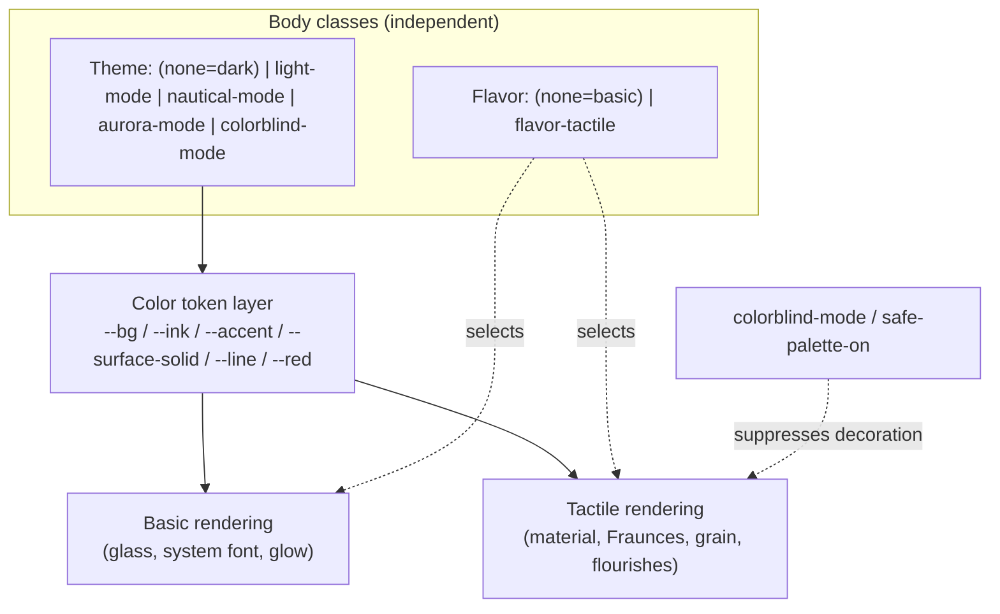

# feat: Add Tactile Flavor design system (Basic/Tactile axis)

## Summary

Introduce a **Flavor** axis to Family Hub — a design-system layer orthogonal to the existing **Theme** (color) axis. `Basic` is today's flat-glass system and remains the untouched default. `Tactile` is a new lush/hand-made system (crafted material surfaces, paper grain, Fraunces display type, ink/rope/compass flourishes, motion) that renders the *same* theme color tokens differently. The direction is already validated end-to-end in a standalone prototype (`family-hub/family-hub/design-lab.html`) across the full Flavor × Theme matrix, mobile, and empty/loading/error states.

The hard constraint: **Basic must be visually and behaviorally unchanged** after this work. Tactile is additive, opt-in, and off by default.

A repository prerequisite — de-nesting the duplicated `family-hub/family-hub/` tree — must land first so all subsequent edits target one canonical copy.

---

## Problem Frame

The live app's three-file CSS (`family-hub.css`, ~155KB) hard-codes one visual treatment per theme: flat semi-transparent glass surfaces, system fonts, neon-glow shadows. There is no way to offer a different *material* treatment without forking each theme. The user wants a modern, lush, hand-made look **without** discarding the existing themes' color identities.

The Flavor concept solves this by separating concerns:
- **Theme** = color tokens only (`--accent`, `--bg`, `--ink`, …). Owned by `applyAppMode()` body classes.
- **Flavor** = how those tokens render into material (surface, shadow, type, radius, motion). New `body.flavor-*` classes.

`Basic × {dark, light, nautical, aurora, colorblind}` is the current product. This plan adds `Tactile × {…}` on top, reading the same tokens, with zero regression to Basic.

**Current blocker:** the working tree at the repo root shows `family-hub.{html,css,js}` as *deleted*, with only `.bak` copies present. The only complete, recently-edited live copy is nested at `family-hub/family-hub/`. Editing must not begin until there is a single canonical copy.

---

## Requirements

- **R1** — Add a Flavor axis with two values: `basic` (default) and `tactile`, persisted in `localStorage` under `fh_flavor`, applied via a `body.flavor-*` class, orthogonal to the existing theme/mode classes.
- **R2** — Basic is the default and is visually + behaviorally identical to today. No regression in any theme (dark, light, nautical, aurora, colorblind).
- **R3** — Tactile renders across all existing themes by consuming shared color tokens, not by redefining colors per theme.
- **R4** — Tactile reproduces the prototype's material: layered surfaces + paper grain, Fraunces (display) + Hanken Grotesk (body), realistic dual shadows, ink-underline / rope / compass flourishes, entrance/hover motion, and the empty/loading/error + budget/meals/assistant treatments.
- **R5** — Fonts load without breaking the CSP and without a third-party runtime dependency unless explicitly chosen (see KTD-3).
- **R6** — A Flavor toggle lives in the Settings → "Look & Feel" panel, mirroring the existing theme mode buttons.
- **R7** — Accessibility modes (`colorblind`, `fh_safePalette`) are not undermined by Tactile's decorative material (see KTD-4).
- **R8** — The duplicated `family-hub/family-hub/` directory tree is resolved to a single canonical copy before design work begins.

---

## Key Technical Decisions

**KTD-1 — Flavor is a body class parallel to theme classes.**
`applyAppMode()` already manages `light-mode` / `nautical-mode` / `aurora-mode` / `colorblind-mode` (dark = no class). Add an independent `applyFlavor(flavor)` that toggles `flavor-tactile` (basic = no class, matching the dark-is-default convention). The two axes never share a class and never reset each other. Rationale: minimal blast radius, mirrors the established mode pattern, keeps Basic as the absence of a class so its cascade is untouched.

**KTD-2 — Restructure theme blocks to expose a shared token vocabulary (chosen over alongside-duplication).**
Refactor `:root` and each `*-mode` block to define a consistent set of tokens both flavors read (`--surface-solid/-hi/-lo`, `--ink`, `--ink-soft`, `--line`, `--red`, plus the existing `--accent` family). Basic's existing rules are rewired to consume these tokens but must compute to the *same* rendered values (verified against pre-change screenshots). Rationale: the alongside-duplication alternative avoids touching Basic's lines but forces Tactile to re-derive per-theme surfaces, duplicating the theme matrix and guaranteeing drift. A shared vocabulary is the whole point of the Flavor idea. The regression risk is contained by the no-visual-change verification gate in U2.

**KTD-3 — Self-host Fraunces + Hanken Grotesk as woff2 (chosen over Google Fonts CDN).**
Current CSP is `font-src 'self' data:` and `style-src 'self' 'unsafe-inline' https://unpkg.com`. Google Fonts would require adding `https://fonts.googleapis.com` to `style-src` **and** `https://fonts.gstatic.com` to `font-src`, plus a runtime dependency on a third-party CDN. Self-hosting woff2 files under `fonts/` needs **no CSP change** (`font-src 'self'` already permits it), adds no third-party dependency, and is faster/offline-friendly (the app is a PWA with a service worker). Cost: a few binary assets committed to the repo and added to the SW precache. Use variable woff2 to keep Fraunces' optical-size/weight range. Rationale: the architecture invariant (CDN-only libraries) is about JS libraries; fonts as local assets better fit the no-build, offline-capable PWA model and avoid widening the CSP.

**KTD-4 — Tactile yields to accessibility modes.**
When `colorblind-mode` is active or `fh_safePalette` is on, suppress Tactile's purely decorative material (grain, glow, compass watermark, ambient gradients) even if `flavor-tactile` is set — keep the structural Tactile choices (type, spacing, radius) that don't affect color discrimination. Implement as CSS overrides scoped to `body.colorblind-mode.flavor-tactile` / `body.safe-palette-on.flavor-tactile`. Rationale: R7 — decorative texture and low-contrast glows can defeat the purpose of an accessibility palette.

**KTD-5 — De-nest by promoting the nested copy to the repo root.**
The nested `family-hub/family-hub/` copy is the canonical one (most recent edits, complete file set). Resolve the nesting so the app files live at the repo root that Netlify publishes (`publish = "."`), matching the architecture invariant that all three files sit in the same directory. Confirm the embedded `.git` directories are not nested submodules before moving. Rationale: editing the wrong copy or serving a stale one is the highest-probability footgun in this whole effort.

---

## High-Level Technical Design

The cascade after this change — two independent body-class axes feeding one render layer:

Both flavors consume the same token layer; the active `flavor-*` class selects which render rules apply. Accessibility modes prune Tactile's decorative output.

---

## Implementation Units

### U1. De-nest the repository to a single canonical copy

**Goal:** Establish one authoritative set of `family-hub.{html,css,js}` (and supporting files) at the repo root that Netlify publishes, eliminating the `family-hub/family-hub/` nesting and the stale root-level `.bak` files.

**Requirements:** R8

**Dependencies:** none (prerequisite for everything else)

**Files:**
- Move `family-hub/family-hub/family-hub.{html,css,js}` (and any newer siblings) to repo root
- Resolve/remove the intermediate `family-hub/` copy and root `.bak` files
- Verify `netlify.toml` (`publish = "."`), `sw.js` precache list, and relative asset paths still resolve

**Approach:** First confirm whether the embedded `.git` directories under `family-hub/` are real submodules or stray clones (`git submodule status`, inspect `.gitmodules`). If stray, the nested trees can be flattened safely. Promote the nested canonical copy to the root, delete duplicates and `.bak` files, and re-stage in git so `family-hub.{html,css,js}` are tracked at the root again. This unit changes **no application behavior** — it only relocates files.

**Patterns to follow:** Architecture invariant — all three files in one directory, served from `publish = "."`.

**Test scenarios:** `Test expectation: none -- file relocation only, no behavior change.` Verification covers correctness.

**Verification:** Repo root contains exactly one `family-hub.{html,css,js}`; `git status` shows them tracked (not deleted); serving the root (`python3 -m http.server`) loads the app with all assets, and the service worker registers without 404s.

---

### U2. Restructure theme blocks into a shared token vocabulary

**Goal:** Refactor `:root` and every `*-mode` block to expose the token set both flavors consume, while Basic renders byte-for-byte identically.

**Requirements:** R1, R2, R3

**Dependencies:** U1

**Files:**
- `family-hub.css` (`:root`, `body.light-mode`, `body.nautical-mode`, `body.aurora-mode`, `body.colorblind-mode` token blocks)

**Approach:** Add the shared tokens (`--surface-solid`, `--surface-hi`, `--surface-lo`, `--ink`, `--ink-soft`, `--line`, `--red`, and confirm `--accent` family) to each theme block, derived from each theme's existing colors so Basic's computed surfaces/shadows are unchanged. Rewire Basic's `.card`, header, and component rules to reference the tokens **only where the resolved value is provably identical**. Where a Basic rule already hard-codes a value that equals the token, prefer leaving it or pointing it at the token — never change the rendered pixel. Map the prototype's token names to the live ones (lab `--surface-solid/-hi/-lo` already match the intended names; lab `.card-head` → live `.card-header`).

**Patterns to follow:** Existing `:root` token block and the `nautical-mode` override block in `family-hub.css`; the prototype's token layer in `design-lab.html`.

**Test scenarios:** `Test expectation: none -- no behavioral change; this is a no-visual-change refactor verified by screenshot diff.`

**Verification:** Capture before/after screenshots of all five themes in Basic; they must be visually identical. Computed styles for `.card` background/box-shadow/border-radius match pre-change values in each theme.

---

### U3. Add self-hosted display + body fonts

**Goal:** Make Fraunces (display) and Hanken Grotesk (body) available to the app without a CSP change or third-party runtime dependency.

**Requirements:** R5

**Dependencies:** U1

**Files:**
- `fonts/` (new) — variable woff2 files for Fraunces and Hanken Grotesk
- `family-hub.css` — `@font-face` declarations; font-family custom properties (`--font-display`, `--font-body`) defined but **only consumed under Tactile**
- `sw.js` — add font files to the precache list
- `family-hub.html` — optional `<link rel="preload">` for the two faces

**Approach:** Self-host per KTD-3. Declare `@font-face` with `font-display: swap`. Define `--font-display`/`--font-body` custom properties; Basic continues to use the system stack (these properties are referenced only by `flavor-tactile` rules, so adding them is inert for Basic). No change to `font-src` needed.

**Patterns to follow:** Existing asset references in `family-hub.html` and the SW precache list in `sw.js`.

**Test scenarios:** `Test expectation: none -- asset + declaration only; exercised visually in U4.`

**Verification:** Fonts load from `'self'` with no CSP violations in console; `document.fonts.check()` reports the families available; Basic still renders in the system stack.

---

### U4. Add the Tactile flavor CSS layer

**Goal:** Implement `body.flavor-tactile` rendering — material surfaces, grain, type, radius, shadows, entrance/hover motion — mapped onto the live component classes.

**Requirements:** R3, R4

**Dependencies:** U2, U3

**Files:**
- `family-hub.css` — new `/* ── Tactile Flavor ── */` section: `body.flavor-tactile` token-rendering overrides + per-component rules (`.card`, `.card-header`, calendar, weather, lists, buttons, inputs)

**Approach:** Port the prototype's `.flavor-tactile` rules, remapping lab class names to live ones (notably `.card-head` → `.card-header`). Use the grain data-URI, layered surface gradient, dual shadow, ink-underline SVG accent, and rise/hover animations from the prototype. All rules are scoped under `body.flavor-tactile` so Basic is never touched. Respect `prefers-reduced-motion`. Keep tap-target rules inside `@media (hover: none)` per the architecture invariant.

**Patterns to follow:** `design-lab.html` `.flavor-tactile` block; existing `.card` / `.card-header` structure in `family-hub.css`.

**Test scenarios:** `Test expectation: none -- CSS-only; verified visually across the matrix.`

**Verification:** With `flavor-tactile` set, dark/light render the crafted material matching the prototype; toggling the class off returns to Basic with no residue; reduced-motion disables entrance animation.

---

### U5. Reconcile nautical flourishes with Tactile

**Goal:** Make the existing nautical decorations (wave banner, anchor watermark, rope header divider, compass-rose glow) render in their lush Tactile form when `flavor-tactile` is active, without regressing Basic·Nautical.

**Requirements:** R4

**Dependencies:** U4

**Files:**
- `family-hub.css` (`body.nautical-mode::before/::after`, `nautical-mode .card-header`, `nautical-mode .cal-card` rules; new `body.flavor-tactile.nautical-mode` enhancements)

**Approach:** Keep the theme-level flourishes (anchor, wave, rope) rendering in both flavors as today. Add `body.flavor-tactile.nautical-mode` enhancements from the prototype: glowing anchor, double-crest wave, compass-rose calendar watermark, softened rope. Reuse the existing `@keyframes nauticalWave`. Confirm the prototype's compass data-URI and overrides map to the live calendar card class.

**Patterns to follow:** Existing `nautical-mode` pseudo-element rules in `family-hub.css`; prototype's `.flavor-tactile.theme-nautical` block.

**Test scenarios:** `Test expectation: none -- CSS-only; verified visually.`

**Verification:** Basic·Nautical is unchanged from today; Tactile·Nautical shows the enhanced flourishes; the compass watermark sits behind (not over) calendar numbers and stays legible.

---

### U6. Tactile state + dense-card treatments

**Goal:** Style empty, loading (skeleton), and error states, plus the denser card types (budget progress bar, meal rows, assistant chips), under Tactile.

**Requirements:** R4

**Dependencies:** U4

**Files:**
- `family-hub.css` — Tactile rules for the live empty/loading/error markup and budget/meals/assistant components
- (only if the live markup lacks needed hooks) minimal class additions in `family-hub.html` / render functions in `family-hub.js`

**Approach:** Map the prototype's states styling (skeleton shimmer, empty/error blocks, budget bar gradient, chips) to the live components: budget card (`#budgetTotalCard`, budget lines), meals, assistant chips (`.meal-adjust-chip`), and whatever empty/loading/error markup each card renders. Prefer styling existing markup; add hook classes only where the live DOM has no selector to target. Verify the coral-red error token reads on the nautical navy (validated in the prototype).

**Patterns to follow:** Existing budget/meal/assistant rendering in `family-hub.js`; prototype's states gallery CSS.

**Test scenarios:** `Test expectation: none -- presentational; verified visually. If U6 adds JS-rendered class hooks, add a DOM assertion that the hook class is present in the rendered node.`

**Verification:** Each state (empty/loading/error) and dense card renders cleanly under Tactile in dark/light/nautical; Basic versions unchanged.

---

### U7. Flavor state, application, and Settings toggle

**Goal:** Wire the runtime: persist `fh_flavor`, apply the body class on load and on change, and add a Basic/Tactile toggle to Settings → Look & Feel.

**Requirements:** R1, R2, R6, R7

**Dependencies:** U4 (so toggling has something to render)

**Files:**
- `family-hub.js` — `fh_flavor` migration/read near other `fh_*` state; `let appFlavor`; `applyFlavor(flavor)`; call from the `load` handler; persist + apply on toggle; KTD-4 accessibility suppression hook; active-button highlight (mirror the `modeXxx` button pattern)
- `family-hub.html` — Flavor toggle buttons (Basic / Tactile) in the `data-panel="look"` settings panel, beside the existing mode buttons
- `family-hub.css` — minimal styling for the toggle buttons if not covered by existing `.btn-sm` / `.btn-mode-active`

**Approach:** Mirror `applyAppMode()`/`appMode`/`fh_mode` exactly for the flavor axis: read `fh_flavor` (default `basic`), set `body.classList.toggle('flavor-tactile', flavor==='tactile')`, persist, and re-highlight the active button (follow the `#modeDark`/`btn-mode-active` pattern). Apply on `load` after `applyAppMode(appMode)`. For KTD-4, the CSS suppression is automatic via the compound selectors, but ensure no JS forces decoration on. Per the Settings checklist in CLAUDE.md, persist + apply **before** any re-render that could throw.

**Patterns to follow:** `applyAppMode()` (line ~8734), the `fh_mode` read/migration (lines ~163-166), and the `modeLight/Dark/Nautical` button wiring (lines ~8909-8912) in `family-hub.js`; the `data-panel="look"` mode buttons in `family-hub.html`.

**Test scenarios:**
- Happy path: `applyFlavor('tactile')` adds `flavor-tactile` to `<body>` and writes `fh_flavor=tactile`; `applyFlavor('basic')` removes it and writes `basic`.
- Default/empty: with no `fh_flavor` in localStorage, load resolves to `basic` and adds no flavor class.
- Persistence: after setting Tactile and reloading, the body class is restored from `fh_flavor`.
- Orthogonality: changing theme (`applyAppMode`) does not clear the flavor class, and vice versa.
- Accessibility (KTD-4): with `colorblind-mode` active and `flavor-tactile` set, decorative material (grain/glow/compass) is suppressed while structural Tactile (type/radius) remains.
- `Covers R2.` Toggling Basic produces a DOM state identical to never having enabled Tactile (no stray classes/attributes).

**Execution note:** The pure resolution logic (default + persistence key) is unit-testable with `node --test`; extract it if cheap, otherwise verify via DOM/state inspection per project norm.

**Verification:** Toggle in Settings flips the whole UI between Basic and Tactile live; selection survives reload; the active button highlights; accessibility modes suppress decoration.

---

## Scope Boundaries

**In scope:** the Flavor axis (Basic/Tactile), token restructure, Tactile CSS + flourishes + states, self-hosted fonts, the Settings toggle, and the directory de-nesting prerequisite.

### Deferred to Follow-Up Work
- Tactile-specific polish passes (grain intensity, shadow depth, type-scale tuning) beyond matching the prototype.
- Extending/auditing Tactile against `aurora-mode` specifically — Tactile will inherit aurora's tokens and should work, but aurora's 47 bespoke rules warrant a dedicated visual pass if it's promoted from "should work" to "supported."
- Any redesign of Basic, new themes, or new feature cards.

**Out of scope (non-goals):** changing Basic's appearance; adding a build step; converting fonts to a CDN dependency; altering mobile *behavior* beyond restyling under Tactile.

---

## System-Wide Impact

- **Service worker / PWA:** new font assets must be precached (U3) or first offline load misses them.
- **CSP:** unchanged under the chosen self-host path (KTD-3) — a deliberate outcome, not an oversight.
- **Accessibility:** colorblind/safe-palette interaction is explicitly handled (KTD-4); the contrast bar (WCAG AA) still applies to Tactile surfaces.
- **Theme matrix:** five themes × two flavors = ten combinations to eyeball; dark/light/nautical are first-class, aurora/colorblind verified for "no breakage" not "designed."
- **Docs:** `CLAUDE.md` (architecture invariants — currently says "three themes"; add the Flavor axis and correct/clarify the theme count) and `FEATURES.md` (function/state/anchor/key for `applyFlavor`, `fh_flavor`).

---

## Risks & Mitigations

- **Token refactor regresses Basic (highest risk).** Mitigation: U2 is a strict no-visual-change refactor gated by before/after screenshot comparison across all five themes; touch only rules whose resolved value is provably identical.
- **De-nesting corrupts git history or submodules.** Mitigation: U1 verifies submodule status before moving; the `.bak` files remain as a fallback until the move is confirmed serving correctly.
- **Tactile decoration harms colorblind/safe-palette users.** Mitigation: KTD-4 suppression selectors.
- **Font assets bloat the repo / SW cache.** Mitigation: variable woff2 (two files), added deliberately to precache.
- **Prototype-to-live class drift** (`.card-head` vs `.card-header`, calendar/weather selectors). Mitigation: U4/U5/U6 each call out the remap explicitly; verify selectors against live DOM before relying on them.

---

## Sources & Research

- Prototype: `family-hub/family-hub/design-lab.html` (full Flavor × Theme matrix, mobile, states) and `family-hub/family-hub/mobile-frame.html`.
- Live code grounding: `applyAppMode()` and `fh_mode` handling in `family-hub.js`; the CSP, font, and Settings markup in `family-hub.html`; theme/token and `nautical-mode` blocks in `family-hub.css`.
- Project memory: the Flavor-axis architecture note (Basic/Tactile orthogonal to dark/light/nautical), including the directory-nesting caveat.
- No external research required — internal CSS architecture with strong local patterns and a working prototype.
